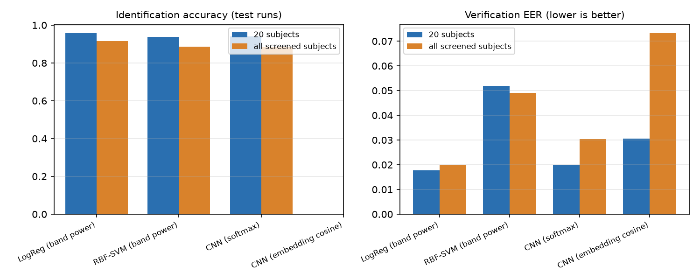

# EEG-Auth

**EEG-based user authentication, with spoofing and adversarial-robustness evaluation.**

EEG-Auth verifies a person's identity from 2-second clips of scalp EEG, then tests how easily that verifier can be fooled. The repository contains the full pipeline: data preparation, classical and neural models, attacks, defenses, a REST login demo, and a written report. Every number in this document is produced by code in this repository.

  

> The project folder may appear locally as "ECG brain authentication" for historical reasons. The signals used are **EEG** (brain activity).

## Contents

1. [Overview](#overview)
2. [Headline results](#headline-results)
3. [Method](#method)
4. [Findings](#findings)
5. [Getting started](#getting-started)
6. [Login API demo](#login-api-demo)
7. [Repository structure](#repository-structure)
8. [Limitations](#limitations)
9. [Data and citation](#data-and-citation)

## Overview

| Question | Answer in this project |
|---|---|
| Can short EEG clips identify a person? | Yes: about 2% equal error rate (EER) across 106 subjects on unseen recordings. |
| Can the system be fooled? | Yes: replay is accepted ~97% of the time and targeted adversarial perturbations ~94.5% of the time. |
| Do defenses help? | Partly: adversarial training lowers attack success, but at an accuracy cost and without protecting the deployed verifier against adaptive attacks. |

**Scope.** Dataset: PhysioNet EEGMMIDB (64 channels, 160 Hz). 106 of 109 subjects are used; S088, S092 and S100 were excluded because runs 3–7 are not sampled at 160 Hz. A 20-subject configuration is also provided for fast iteration.

## Headline results

All test clips come from recording runs that the models never saw during training (106 subjects: 22,641 training clips, 16,162 test clips).

| Metric | 20 subjects | 106 subjects |
|---|---|---|
| Logistic regression: identification accuracy / EER | 95.80% / 1.77% | 91.54% / 1.98% |
| RBF-SVM: identification accuracy / EER | 93.70% / 5.19% | 88.58% / 4.90% |
| CNN: identification accuracy / EER | 93.99% / 1.98% | 88.34% / 3.04% |
| CNN embedding-cosine EER (used by the API) | 3.05% | 7.33% |
| Zero-effort impostor false-accept rate at the EER threshold | 1.98% | 3.06% |
| Replay attack acceptance (unseen recordings) | 98.03% | 96.96% |
| Targeted PGD attack acceptance, ε = 0.05 | 64.0% | 75.0% |
| Targeted PGD attack acceptance, ε = 0.1 | 96.0% | 94.5% |
| PGD ε = 0.1 after adversarial training | 92.0% | 86.5% |
| Clean EER, before → after adversarial training | 1.98% → 2.36% | 3.04% → 4.42% |
| Replay success with simulated challenge-response (k = 1…4) | 12.4 / 25.6 / 35.5 / 47.0% | 10.2 / 21.3 / 29.0 / 40.4% |

*ε is an L∞ bound in per-channel-normalised units. At ε = 0.1 the perturbation has an L2 norm of about 14% of the signal. The complete table is in [`results/final/final_results.md`](results/final/final_results.md).*

| | |
|---|---|
|  |  |
|  |  |

## Method

**1. Data.** EEGMMIDB EDF files are band-pass filtered (1–40 Hz) and cut into non-overlapping 2-second clips of shape 64 × 320.

**2. Leak-free split.** Enrollment/training runs are `{1, 3, 4, 5}`; test runs are `{2, 6, 7}`. A run never appears on both sides (checked in code and in tests). Scalers and normalisers are fitted on training data only, and early stopping uses a validation split of training runs.

**3. Models.**
- *Baselines:* log band power (theta, alpha, beta, gamma, via Welch) for each of 64 channels gives 256 features, followed by standardisation and logistic regression or an RBF-SVM.
- *CNN:* a compact EEGNet-style 1D convolutional network (~105k parameters) on raw clips.

**4. Verification protocol.** For each test clip the genuine score is the score of its true identity; the impostor scores are those of every other claimed identity. We report ROC, AUC, EER, and FAR/FRR at the EER threshold.

**5. Attacks.**
- *Zero-effort impostor:* an attacker submits their own EEG under another identity.
- *Replay:* previously recorded genuine clips are resubmitted.
- *Adversarial:* targeted white-box FGSM and PGD perturbations, swept over six ε values with 200 attacker–victim pairs each.

**6. Defenses.**
- *Adversarial training:* the CNN is trained on clean plus PGD examples.
- *Challenge-response (simulation):* the system asks for a task and a classifier checks that the response matches. This uses dataset task labels and is a simulation, not a live protocol.

**7. API.** The demo service verifies by cosine similarity between a clip's CNN embedding and a per-user template, so new users can be enrolled without retraining.

## Findings

- **A simple model is the best verifier.** Band-power logistic regression reaches ~2% EER at 106 subjects; the CNN does not beat it under a cross-run protocol.
- **Scale costs accuracy.** Going from 20 to 106 subjects lowers identification accuracy by 4–6 points for every model.
- **Replay cannot be fixed by the model.** A recording of a genuine clip looks identical to a live one, so only liveness checks can help.
- **Adversarial attacks are effective.** About 94.5% targeted acceptance at ε = 0.1, against the undefended CNN.
- **Adversarial training is a partial remedy.** At ε = 0.1 acceptance falls from 94.5% to 86.5%, but clean EER rises by about 1.4 points and ε = 0.02 gets slightly worse (23.5% → 25.5%). In the 20-subject API demo it did not stop an adaptive attack on the embedding matcher (100% → 100%, n = 30).
- **Challenge-response is promising but weak here.** It cuts replay success to 10–40%, but the task decoder is only 46% accurate on four classes.

Details and discussion: [`report/report.md`](report/report.md).

## Getting started

**Requirements:** Python 3.12; about 10 GB of free disk for the full run (raw EDF files ≈ 2 GB plus caches). `data/` and `models/` are created by the scripts and are not committed. Training uses Apple MPS if available, otherwise CPU.

```bash
python3.12 -m venv .venv
source .venv/bin/activate
pip install -r requirements.txt
pytest -m "not slow"                        # fast unit tests
```

**20-subject experiment** (quick):

```bash
python scripts/build_dataset.py             # downloads data from PhysioNet
python scripts/run_baseline.py
python scripts/run_cnn.py
python scripts/run_attacks.py
python scripts/run_defenses.py
python scripts/eval_embeddings.py --checkpoint cnn
python scripts/eval_embeddings.py --checkpoint cnn_robust
```

**106-subject experiment** (full):

```bash
python scripts/download_all.py              # download and screen sampling rates
bash scripts/run_full.sh                    # dataset, baselines, CNN, attacks, embeddings
python scripts/run_defenses.py --config configs/full109.yaml
python scripts/make_figures.py              # writes results/final/
```

Seeds (Python, NumPy, PyTorch = 42) are set in the configs and saved with every result file.

## Login API demo

```bash
python scripts/demo_api.py                  # enroll A, verify A, B claims A, adversarial clip
uvicorn --factory eegauth.api.app:create_app --app-dir src
```

| Endpoint | Purpose |
|---|---|
| `POST /enroll` | Create a user template from enrollment clips (`.npy` or 160 Hz `.edf`). |
| `POST /verify` | Compare a probe to the user's template; returns a JWT on accept. |
| `GET /health` | Service status. |

Inputs are validated (shape, sampling rate, finite values, user-id format), data is isolated per user, and duplicate or unknown users return 409 / 404. **For demonstration only:** the JWT secret is a config constant and the diagnostic `/token/decode` endpoint must not be deployed.

## Repository structure

```
configs/
  default.yaml            20-subject configuration
  full109.yaml            106-subject configuration (outputs to results/full109/)
src/eegauth/
  data.py                 download, filter, epoch, run-based split, caching
  features.py             Welch band-power features
  models.py, train.py     1D CNN, baselines, training loop
  metrics.py              ROC / EER / FAR / FRR protocol
  attacks.py              impostor, replay, FGSM, PGD
  defenses.py             adversarial training, challenge-response simulation
  api/                    FastAPI service (app.py, ingest.py)
scripts/                  entry points (run_*.py, make_figures.py, demo_api.py, run_full.sh)
tests/                    pytest suite (fast unit tests and slow real-data tests)
results/                  metrics and figures: 20 subjects, results/full109/, results/final/
report/report.md          full write-up
```

## Limitations

- Public laboratory data; no consumer EEG hardware and no live acquisition.
- "Sessions" are runs within the same visit. Run-level separation reduces, but does not remove, within-day correlation, so real cross-day error rates would likely be higher.
- Single random seed, and no confidence intervals beyond the larger attack-pair count.
- Attacks are digital and white-box; physical feasibility is not evaluated.
- Challenge-response is simulated from dataset task labels.
- The reference electrode (C4) is kept to preserve the 64-channel input.

## Data and citation

Data: [PhysioNet EEG Motor Movement/Imagery Dataset](https://physionet.org/content/eegmmidb/1.0.0/) (Open Data Commons Attribution License). Please cite:

- Schalk, G., McFarland, D.J., Hinterberger, T., Birbaumer, N., Wolpaw, J.R. BCI2000: A General-Purpose Brain-Computer Interface (BCI) System. *IEEE Transactions on Biomedical Engineering* 51(6), 2004.
- Goldberger, A. et al. PhysioBank, PhysioToolkit, and PhysioNet. *Circulation* 101(23), 2000.
