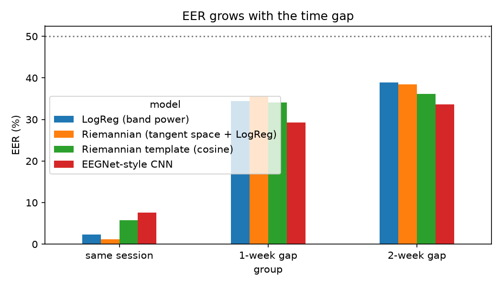
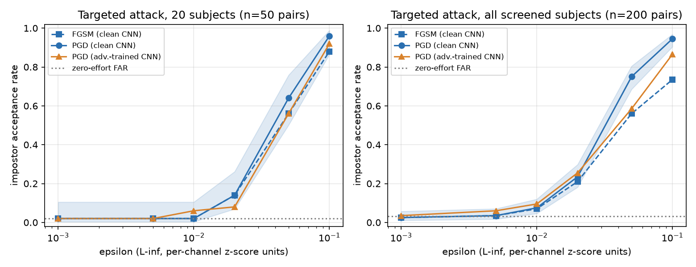

# EEG-Auth

I wanted to see whether brain signals can be used to log someone in, and how easily such a system can be fooled. So I built a small EEG verifier and then tried to break it.

It identifies people well on normal recordings (about 2% error), but it is easy to fool: replaying a genuine recording gets accepted almost every time, and a small crafted change to the signal gets an impostor accepted about 94% of the time. Adversarial training helped only a little. When I tested across days on a second dataset (BED), the error rose from about 1–8% within a session to roughly 34–39% a week later. Details are below.

## Dataset

I used the public [PhysioNet EEG Motor Movement/Imagery Database](https://physionet.org/content/eegmmidb/1.0.0/) (64 channels, 160 Hz, 109 volunteers). Three subjects (S088, S092, S100) were left out because some of their runs aren't recorded at 160 Hz, so everything below uses **106 subjects**.

Signals are filtered to 1–40 Hz and cut into 2-second clips. Training uses runs 1, 3, 4 and 5; testing uses runs 2, 6 and 7. No run appears on both sides, so the model is always tested on recordings it has never seen. That gives 22,641 training clips and 16,162 test clips.

## Results

EER is the error rate where false accepts equal false rejects (lower is better). I ran everything on a 20-subject subset first and then on all 106 subjects.

| | 20 subjects | 106 subjects |
|---|---|---|
| Logistic regression (band power): accuracy / EER | 95.80% / 1.77% | 91.54% / 1.98% |
| SVM: accuracy / EER | 93.70% / 5.19% | 88.58% / 4.90% |
| CNN: accuracy / EER | 93.99% / 1.98% | 88.34% / 3.04% |
| Random impostor accepted | 1.98% | 3.06% |
| Replay of a genuine recording accepted | 98.03% | 96.96% |
| Adversarial attack accepted (PGD, ε = 0.05) | 64.0% | 75.0% |
| Adversarial attack accepted (PGD, ε = 0.1) | 96.0% | 94.5% |
| Same attack after adversarial training (ε = 0.1) | 92.0% | 86.5% |
| EER before → after adversarial training | 1.98% → 2.36% | 3.04% → 4.42% |

What I take from this:

- The simplest model (logistic regression on band-power features) was the best. The CNN did not beat it.
- Going from 20 to 106 people costs a few points of accuracy, but the EER stays low.
- Replay can't be fixed by a better model. A recording of you looks the same as you.
- Adversarial training lowered the attack success from 94.5% to 86.5%, but it made the clean error worse, and at the smallest perturbation it was slightly worse than no defense. It is a partial fix at best.

I also simulated a challenge-response check against replay (the user is asked to do a task and the system checks it). It cut replay success to roughly 10–40%, but the task classifier is weak (46% accuracy on four tasks), so treat it as a rough idea, not a working defense.

### Across days: BED dataset

EEGMMIDB is a single visit, so I also tested on [BED](https://zenodo.org/records/4309471) (21 subjects, 14-channel Emotiv headset, 3 sessions one week apart; the data is restricted so it is not in this repo). I ran ten experiments in `notebooks/colab_bed.ipynb`; every number is in `results/bed/results.md`. EER (lower is better, 50% is chance):

| Test | Logistic regression | Riemannian | Template matching | CNN (5 seeds) |
|---|---|---|---|---|
| Same session | 2.3% | 1.2% | 5.8% | 7.7% |
| 1 week later (enrol on 1 session) | 34.5% | 35.6% | 34.0% | 29.3% |
| 2 weeks later (enrol on 1 session) | 38.9% | 38.4% | 36.2% | 33.6% |



- **Across days it breaks.** Within a session every model works, but a different day gives 29-39% EER. The 2% EER above is optimistic for a real login.
- **Enrolling on two sessions helps most.** Training on two sessions and testing on the third lowered EER in all 12 cases (by 0.5 to 12 points). The best case was the CNN tested on session 2: 31.3% to 19.2%.
- **A little new data helps.** Adding just 5 clips (10 seconds) per user from the new session cut logistic regression from 40.5% to 35.2%. With 80 clips (about 2.7 minutes) template matching went from 35.8% to 28.1%.
- **Averaging several clips helps a bit.** Fusing 5-10 clips per login lowered EER by 2-4 points when enrolled on two sessions (template matching: 26.6% to 23.1%). It did little with one enrolment session.
- **Things that did not help:** per-session alignment (Euclidean alignment made the Riemannian models worse, for example 32.1% to 38.7%), using only eyes-closed or only eyes-open data (no clear difference), and using only alpha-band features (35.7% to 41.8%).
- **Unseen impostors are no harder.** When impostors were people who were never enrolled, the template matcher scored 26.9% EER (enrolled on two sessions), about the same as the normal test (26.6%).
- **Net effect of the improvements.** On session 3, the step-by-step ladder took logistic regression from 40.5% to 31.0% and Riemannian from 39.6% to 37.1%. The CNN barely moved (33.9% to 32.1%), and template matching ended slightly worse (35.8% to 36.7%). The best single numbers I got were about 19-23% EER, which is still far from usable.


The full table and figures are in `results/final/`, and a longer write-up is in `report/report.md`.




## Limitations

- **Same-visit data (EEGMMIDB).** The "sessions" are runs recorded during the same visit, not different days. The BED test above shows real cross-day error is much higher.
- **BED is small.** Only 21 subjects and resting state only. Logistic regression, Riemannian and template matching ran once (no error bars); only the CNN has 5 seeds, and it was run in four of the ten experiments. The attacks and defenses were not run on BED.
- **Fixes were tested on the same three sessions.** There are only 3 sessions, so the numbers show what helps here, not what will hold on new data.
- **Lab recordings.** The data comes from a research-grade EEG cap. I didn't test a consumer headset or live recording.
- **One seed.** Everything was run with seed 42 and I have no error bars across seeds, so differences of a point or two shouldn't be over-read.
- **Digital, white-box attacks.** The attacker knows the model and edits the signal directly. I didn't test whether this could be done to a real person.
- **Weak defenses.** Adversarial training only partly helped, and in a separate test against the embedding-based matcher used in my API demo it did not help at all (100% accepted before and after, on 30 clips from the 20-subject run).
- **Challenge-response is simulated** from the dataset's task labels, not a real live challenge.

## Running it

```bash
pip install -r requirements.txt
python scripts/build_dataset.py        # downloads the data (20 subjects)
python scripts/run_baseline.py
python scripts/run_cnn.py
python scripts/run_attacks.py
python scripts/run_defenses.py
```

For all 106 subjects, run `bash scripts/run_full.sh` and then `python scripts/run_defenses.py --config configs/full109.yaml` and `python scripts/make_figures.py`. This needs about 10 GB of free disk. There is also a small FastAPI login demo: `python scripts/demo_api.py`.

## Credits

Data: PhysioNet EEGMMIDB (Open Data Commons Attribution License). Please cite Schalk et al., *IEEE Transactions on Biomedical Engineering* 51(6), 2004, and Goldberger et al., *Circulation* 101(23), 2000.
