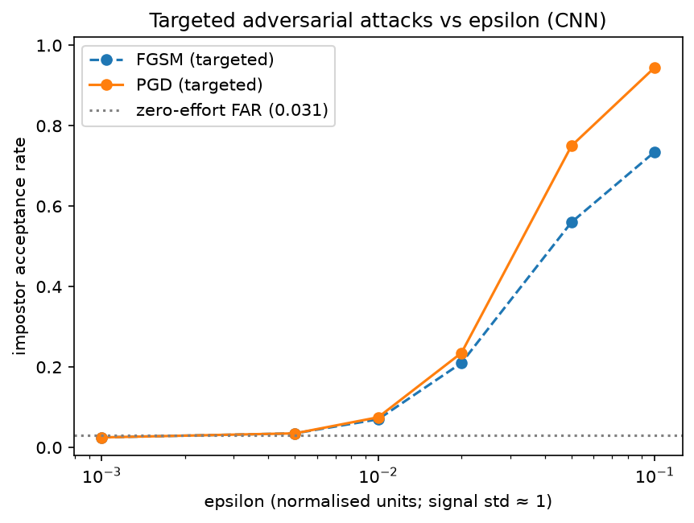

# EEG-Auth

Can brain signals (EEG) be used to log someone in, and how easily can such a login be fooled? I built a small EEG verifier, tested it on two public datasets, and then tried to attack it.

**Short answer.** Within one recording visit it works well (about 2% error on 106 people). It is easy to fool: a replayed recording gets accepted almost every time, and a small crafted change to the signal gets an impostor accepted about 94% of the time. On a different day, error jumps to 29-39%. The best fixes I found only got it down to about 19-23%, which is still too high for a real login.

EER (equal error rate) is the error where false accepts equal false rejects. Lower is better; 50% is chance.

## Datasets

| | EEGMMIDB | BED |
|---|---|---|
| Source | [PhysioNet](https://physionet.org/content/eegmmidb/1.0.0/) (public) | [Zenodo 4309471](https://zenodo.org/records/4309471) (restricted, not in this repo) |
| People | 109 recorded, 106 used | 21 |
| Headset | 64 channels, research cap, 160 Hz | 14 channels, Emotiv EPOC+ consumer headset, 256 Hz (resampled to 160 Hz) |
| Sessions | One visit | 3 sessions, one week apart |
| Signal used | Motor movement / imagery runs | Resting state, eyes open / closed |
| Used to answer | How accurate is the verifier, and how easy is it to attack? | Does it still work on a different day? |

The two datasets use different people and headsets, so their numbers should not be compared directly.

Both use 1-40 Hz filtered, 2-second clips. On EEGMMIDB, runs 1/3/4/5 are for training and runs 2/6/7 for testing (22,641 / 16,162 clips), so the model is always tested on recordings it never saw. BED details are in [`report/report.md`](report/report.md).

## Results: EEGMMIDB (one visit)

| Experiment | 20 people | 106 people |
|---|---|---|
| Logistic regression: accuracy / EER | 95.80% / 1.77% | 91.54% / 1.98% |
| SVM: accuracy / EER | 93.70% / 5.19% | 88.58% / 4.90% |
| CNN: accuracy / EER | 93.99% / 1.98% | 88.34% / 3.04% |
| Random impostor accepted | 1.98% | 3.06% |
| Replay of a genuine recording accepted | 98.03% | 96.96% |
| Adversarial attack (PGD) accepted, small change (ε = 0.05) | 64% | 75.0% |
| Adversarial attack (PGD) accepted, larger change (ε = 0.1) | 96% | 94.5% |
| Same attack after adversarial training (ε = 0.1) | 92% | 86.5% |
| Clean EER before → after adversarial training | 1.98% → 2.36% | 3.04% → 4.42% |
| Replay accepted with simulated challenge-response | 12-47% | 10-40% |

ε = 0.1 means the signal is changed by about 14% of its size.



## Results: BED (different days)

EER %, 21 people, enrolled on one session:

| Test | Logistic regression | Riemannian | Template matching | CNN (5 seeds) |
|---|---|---|---|---|
| Same session | 2.3 | 1.2 | 5.8 | 7.7 |
| 1 week later | 34.5 | 35.6 | 34.0 | 29.3 |
| 2 weeks later | 38.9 | 38.4 | 36.2 | 33.6 |


What I tried to improve the cross-day result:

| Idea | Result |
|---|---|
| Enrol on two sessions instead of one | Better in all 12 cases (0.5 to 12.1 points). Best: CNN on session 2, 31.3% → 19.2% |
| Add a few clips from the new session | 5 clips (10 s): logistic regression 40.5% → 35.2%. 80 clips (~2.7 min): template matching 35.8% → 28.1% |
| Average several clips per login | About 3 points better with two enrolment sessions (template 26.6% → 23.1%), little with one |
| Session alignment | No consistent gain; Euclidean alignment made Riemannian worse (32.1% → 38.7%) |
| Eyes-closed or eyes-open only | No consistent difference |
| Alpha band only | Worse (35.7% → 41.8%) |
| Impostors who were never enrolled | 26.9% EER, same as normal (26.6%) |

All tables are in [`report/report.md`](report/report.md).


## Findings

1. A simple model wins. Logistic regression on band power was the best verifier (1.98% EER); the CNN did not beat it.
2. More people costs a little. Going from 20 to 106 people lowers accuracy by 4-6 points, but EER stays near 2%.
3. Replay can't be fixed by a better model. A recording of you looks the same as you.
4. Small crafted changes fool the CNN. About 94.5% of impostor attempts were accepted at ε = 0.1.
5. Adversarial training only partly helps. Attack success fell from 94.5% to 86.5%, but clean error rose and it was slightly worse at the smallest change.
6. Challenge-response looks promising in simulation (replay success 10-47%), but the task classifier is weak and it was never tested live.
7. The 2% EER does not carry over to other days. On BED it is 29-39% on a different day (chance is 50%).
8. It is not just elapsed time. Pairs involving session 1 are worse than session 2 vs 3 (CNN: 35.0% vs 23.4%), so session 1 simply differs from the others.
9. The fixes that worked all gave the model data from more than one session. Fixes that tried to remove the session difference without labels did not work here.
10. Nothing reached a usable error rate. The best results were about 19-23% EER.

## Limitations

- **EEGMMIDB is one visit.** Its "sessions" are runs from the same visit, not different days.
- **BED is small.** 21 people, resting state only, 3 sessions.
- **Few error bars.** Only the CNN on BED has them (5 seeds, in four of ten experiments). Everything else ran once, so differences of a point or two mean little.
- **Fixes were tuned and tested on the same three sessions.** They show what helps here, not what will hold on new data.
- **Attacks are digital and white-box.** The attacker knows the model and edits the signal directly. Nothing was tested on a real person.
- **Challenge-response is simulated** from the dataset's task labels.
- **Attacks and defenses were not run on BED.**
- **The two datasets can't be compared directly.**

## Running it

```bash
pip install -r requirements.txt
python scripts/build_dataset.py        # downloads data (20 people)
python scripts/run_baseline.py
python scripts/run_cnn.py
python scripts/run_attacks.py
python scripts/run_defenses.py
```

For all 106 people run `bash scripts/run_full.sh` (about 10 GB of disk). For BED, upload the `RAW_PARSED` `.mat` files to Google Drive, open `notebooks/colab_bed.ipynb` in Colab, set `DRIVE_BED_DIR` and run all. Never commit BED data.

## Credits

Data: PhysioNet EEGMMIDB. Cite Schalk et al., *IEEE Trans. Biomedical Engineering* 51(6), 2004, and Goldberger et al., *Circulation* 101(23), 2000. For BED, cite Arnau-González et al., *IEEE Internet of Things Journal* 8(15), 2021.
