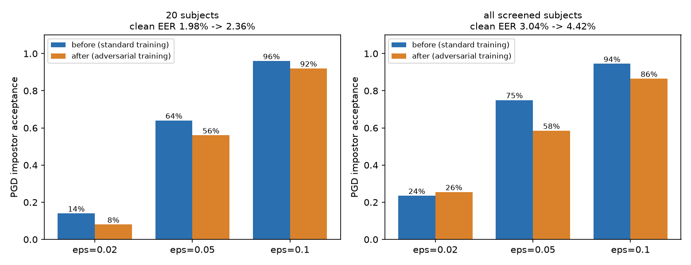
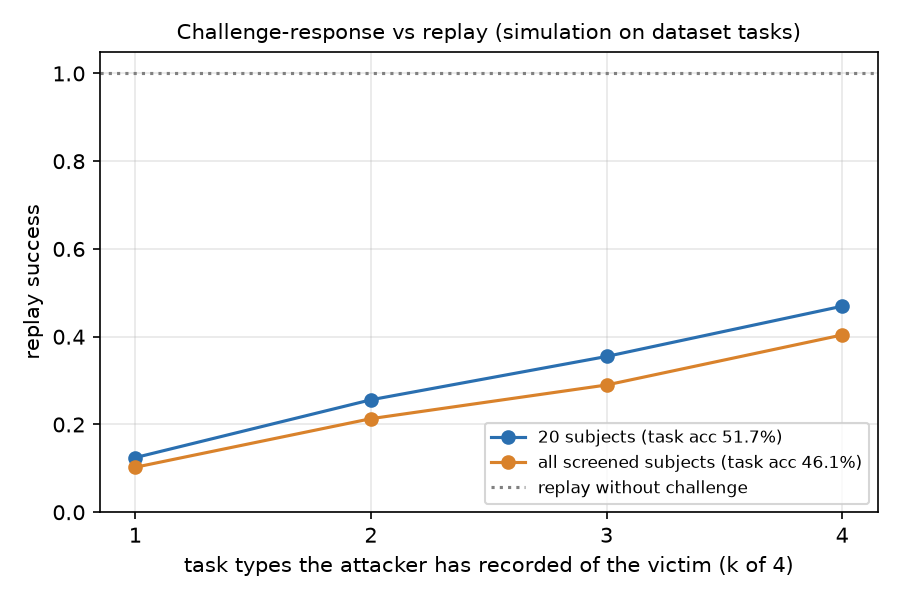

# EEG-Auth: EEG-Based User Authentication with Spoofing and Adversarial-Robustness Evaluation

An end-to-end research project: build a user-verification system from short scalp-EEG clips, **attack it**, **defend it**, and report honestly how well each step worked. Everything (data pipeline, models, attacks, defenses, a FastAPI login demo, figures, report) is in this repository, and every number below is produced by code in `scripts/`.

> Note: the folder name on the author's machine says "ECG", but the project uses **EEG** (brain) signals.

## What was done

1. **Data pipeline** – PhysioNet [EEGMMIDB](https://physionet.org/content/eegmmidb/1.0.0/) (64 channels, 160 Hz). Band-pass 1–40 Hz, cut into non-overlapping 2 s clips (64 × 320).
2. **Leak-free protocol** – train/enrollment runs `{1,3,4,5}`, test runs `{2,6,7}`. No recording run is on both sides (enforced in code and tested). Normalisation is fitted on training data only.
3. **Models** – (a) Welch log band-power features (256) + Logistic Regression / RBF-SVM; (b) a compact EEGNet-style 1D CNN (~105k parameters) on raw clips.
4. **Verification metrics** – ROC, AUC, EER, FAR/FRR at the EER threshold.
5. **Attacks** – zero-effort impostor, replay of genuine clips, targeted white-box FGSM and PGD at several perturbation sizes.
6. **Defenses** – PGD adversarial training; a *simulated* challenge-response scheme against replay.
7. **Login API demo** – FastAPI `/enroll`, `/verify` (JWT on accept), `/health`, with input validation and per-user isolation.
8. **Scaling** – repeated on all usable subjects (106 of 109; S088, S092 and S100 were excluded because runs 3–7 are not sampled at 160 Hz).

## Results

Test clips come only from runs never seen in training (106 subjects: 22,641 train / 16,162 test clips).

| Metric | 20 subjects | 106 subjects |
|---|---|---|
| LogReg identification accuracy / EER | 95.80% / 1.77% | 91.54% / 1.98% |
| SVM identification accuracy / EER | 93.70% / 5.19% | 88.58% / 4.90% |
| CNN identification accuracy / EER | 93.99% / 1.98% | 88.34% / 3.04% |
| CNN embedding-cosine EER (API verifier) | 3.05% | 7.33% |
| Zero-effort impostor FAR at EER threshold | 1.98% | 3.06% |
| Replay acceptance (unseen test recordings) | 98.03% | 96.96% |
| PGD attack acceptance, ε = 0.05 | 64.0% | 75.0% |
| PGD attack acceptance, ε = 0.1 | 96.0% | 94.5% |
| PGD ε = 0.1 after adversarial training | 92.0% | 86.5% |
| Adversarial training cost: clean EER | 1.98% → 2.36% | 3.04% → 4.42% |
| Replay success with challenge-response (k = 1…4, simulated) | 12.4 / 25.6 / 35.5 / 47.0% | 10.2 / 21.3 / 29.0 / 40.4% |

ε is an L∞ bound in per-channel-normalised units; at ε = 0.1 the perturbation is about 14% of the signal's L2 norm. The full table is `results/final/final_results.md`.

### Figures

| | |
|---|---|
|  |  |
|  |  |

### Key takeaways

- A simple band-power LogReg is the best verifier (≈2% EER, even with 106 subjects); the CNN is not better under this cross-run protocol.
- Going from 20 to 106 subjects costs 4–6 points of identification accuracy.
- **Replay is accepted ~97% of the time.** A static biometric cannot tell a live user from a recording of that user; only liveness checks can help.
- **Adversarial perturbations work well** (≈94.5% targeted acceptance at ε = 0.1).
- **Adversarial training only partly helps**: 94.5% → 86.5% at ε = 0.1, at a clean-accuracy cost, and slightly worse at ε = 0.02. In the 20-subject API demo it gave no protection against an adaptive attack on the embedding matcher (100% → 100%, n = 30).
- Challenge-response reduces replay success to 10–40%, but its task decoder is weak (46% accuracy), so it is a proof of concept.

## Repository layout

```
configs/default.yaml      20-subject config (subjects, runs, filter, seeds, paths)
configs/full109.yaml      106-subject config (outputs to results/full109/)
src/eegauth/
  data.py                 download, filter, epoch, run-based split, caching
  features.py             Welch log band-power features
  models.py, train.py     1D CNN, baselines, training loop
  metrics.py              ROC / EER / FAR / FRR verification protocol
  attacks.py              FGSM, PGD, replay, impostor attacks
  defenses.py             adversarial training, challenge-response simulation
  api/                    FastAPI login demo (app.py, ingest.py)
scripts/                  run_*.py, build_dataset.py, make_figures.py, demo_api.py, run_full.sh
tests/                    pytest (fast unit tests + slow real-data tests)
results/                  JSON metrics and figures (20 subjects)
results/full109/          106-subject metrics
results/final/            final table and figures
report/report.md          full write-up
```

## Reproduce

Requires Python 3.12 and ~10 GB free disk for the full run (raw EDFs ≈ 2 GB plus caches). `data/` and `models/` are not committed; they are created by the scripts.

```bash
python3.12 -m venv .venv && source .venv/bin/activate
pip install -r requirements.txt

pytest -m "not slow"                       # fast tests
python scripts/build_dataset.py            # 20 subjects; downloads from PhysioNet
python scripts/run_baseline.py
python scripts/run_cnn.py
python scripts/run_attacks.py
python scripts/run_defenses.py
python scripts/eval_embeddings.py --checkpoint cnn
python scripts/eval_embeddings.py --checkpoint cnn_robust

# all 106 subjects
python scripts/download_all.py             # download + screen sampling rates
bash scripts/run_full.sh
python scripts/run_defenses.py --config configs/full109.yaml
python scripts/make_figures.py             # results/final/
```

Seeds (python / numpy / torch = 42) are fixed in the configs and logged with every result. Training uses Apple MPS if available, else CPU.

### Login API demo

```bash
python scripts/demo_api.py                 # enroll A, verify A, B claims A, adversarial clip
uvicorn --factory eegauth.api.app:create_app --app-dir src   # serve the API
```

The API verifies by cosine similarity of the CNN embedding to a per-user template, so new users can enroll without retraining. The JWT secret in the config is a demo constant and the `/token/decode` diagnostic endpoint must not be shipped to production.

## Limitations

- Public lab dataset recorded in controlled conditions; no consumer hardware, no live acquisition.
- "Sessions" are runs within the same visit, so train/test separation reduces but does not remove within-day correlation. Real cross-day EERs would likely be worse.
- 106 of 109 subjects, a single seed, no confidence intervals beyond the larger attack-pair count (200 per ε).
- Attacks are digital and white-box; physical feasibility is not evaluated.
- Challenge-response is a simulation using dataset task labels.
- The EEGMMIDB reference electrode (C4) is kept to preserve the 64-channel input.

## Report and data

Full write-up: [`report/report.md`](report/report.md). Data: PhysioNet EEGMMIDB (Open Data Commons Attribution License); please cite Schalk et al., *IEEE TBME* 51(6), 2004, and Goldberger et al., *Circulation* 101(23), 2000.
