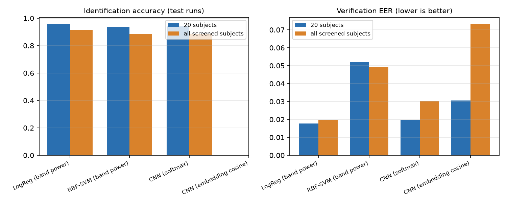
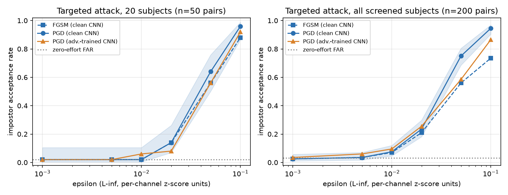
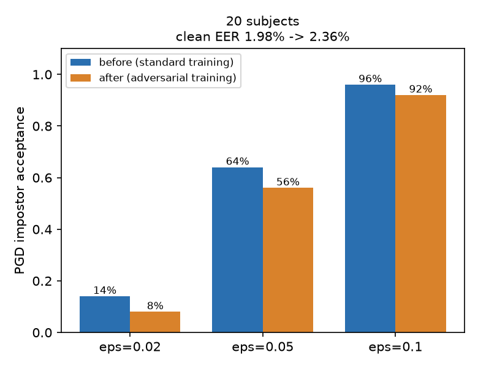
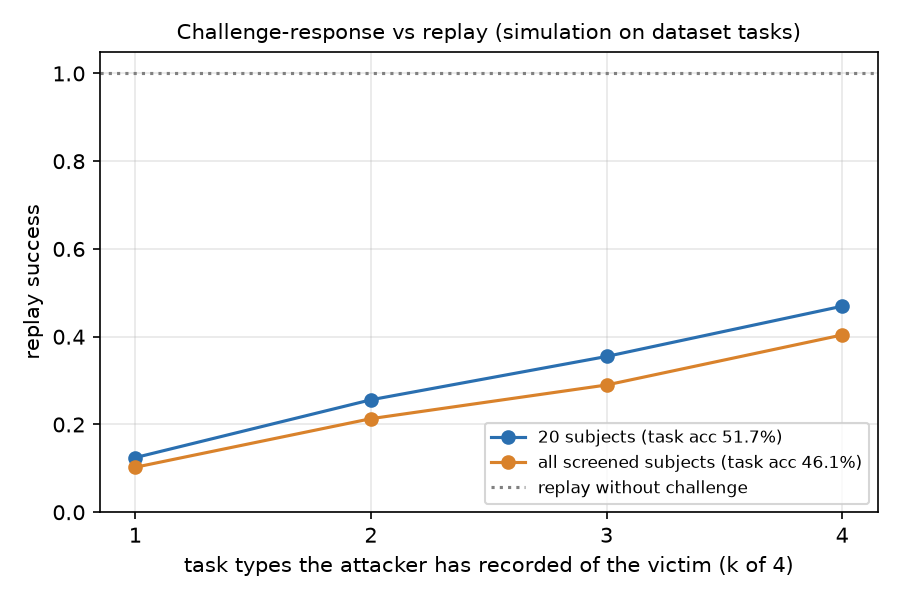
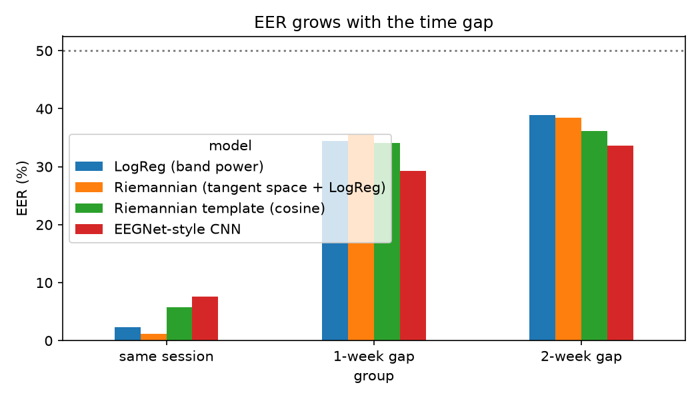
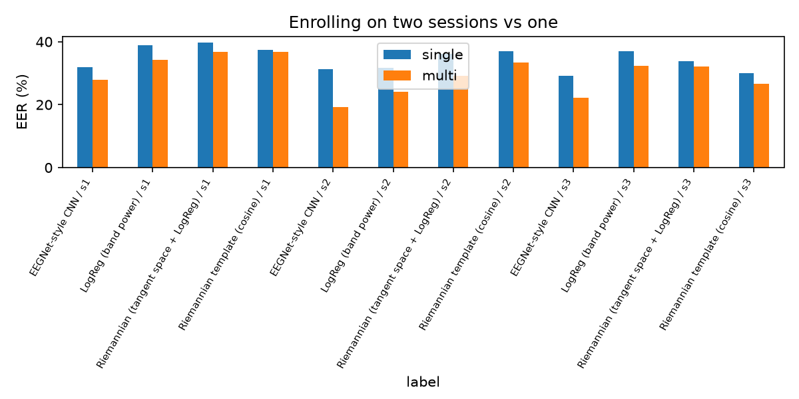
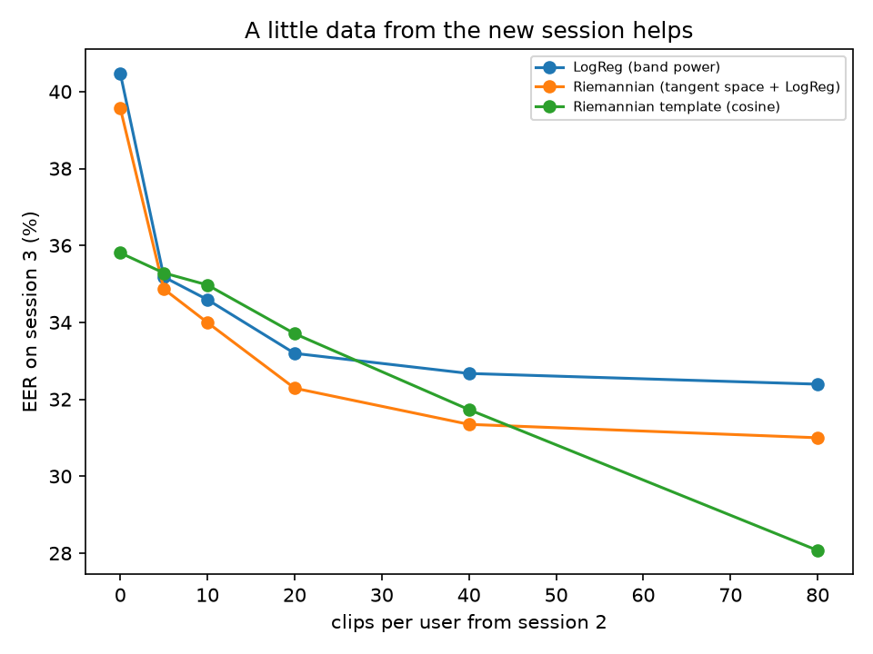
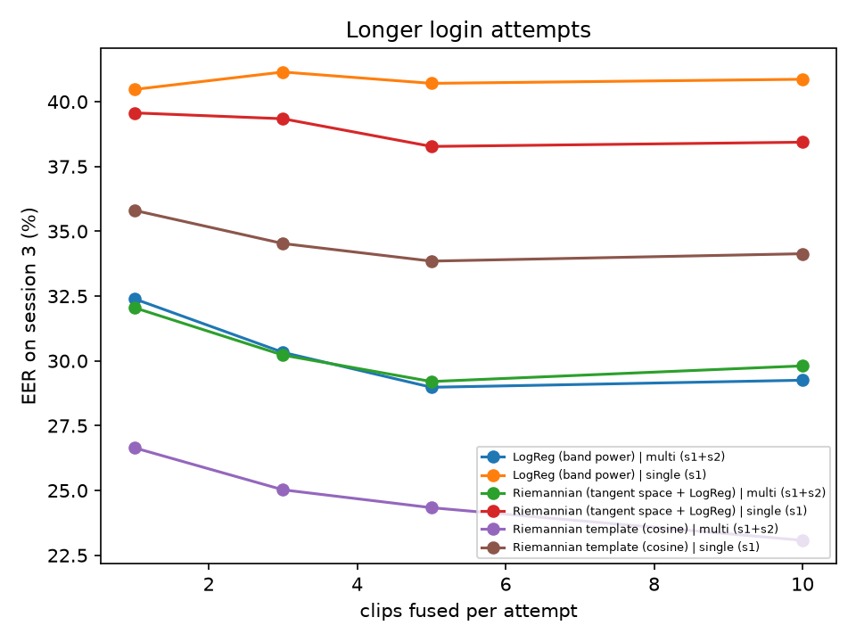
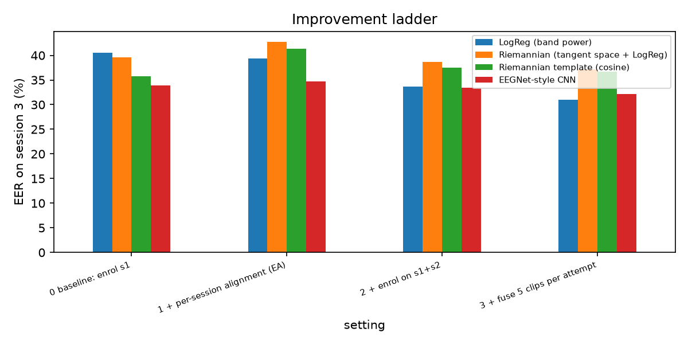

# EEG-Based User Authentication: Spoofing, Adversarial Robustness and Cross-Day Evaluation

Full write-up of the project. The README has the short version; every number here comes from the JSON/CSV files in `results/` (`results/final/`, `results/full109/`, `results/bed/`), written by the scripts in `scripts/` and by `notebooks/colab_bed.ipynb`. Negative results are included.

## Contents
1. Problem
2. Datasets and protocols
3. Methods
4. Results on EEGMMIDB (verifier, attacks, defenses)
5. Results on BED (cross-day)
6. Findings
7. Discussion
8. Limitations
9. Future work
10. Reproducing the results

## 1. Problem
Can short scalp-EEG clips verify identity, and does such a verifier survive realistic attacks? I built a verifier, attacked it (zero-effort impostor, replay, targeted adversarial perturbations), added defenses (adversarial training, a simulated challenge-response), and then asked a different question on a second dataset: does it still work on a different day, and what helps if it does not?

## 2. Datasets and protocols
I used two datasets. They answer different questions, so their numbers should not be compared directly (different headsets, different people).

| | EEGMMIDB (PhysioNet) | BED (Zenodo) |
|---|---|---|
| Question it answers | How good is the verifier, and how easy is it to attack? | Does it still work on a different day? |
| People | 109 volunteers, **106 used** | 21 volunteers |
| Headset | 64 channels, research cap, 160 Hz | 14 channels, Emotiv EPOC+ consumer headset, 256 Hz (resampled to 160 Hz) |
| Sessions | One visit (runs recorded during the same visit) | 3 sessions, one week apart |
| Signal used | Motor movement / imagery runs | Resting state (eyes open / eyes closed) only |
| Access | Public | Restricted: not in this repo, never committed |
| Link | [PhysioNet EEGMMIDB](https://physionet.org/content/eegmmidb/1.0.0/) | [BED, Zenodo 4309471](https://zenodo.org/records/4309471) |

**EEGMMIDB set-up.** Three subjects (S088, S092, S100) were left out because some runs aren't recorded at 160 Hz. Signals are filtered to 1-40 Hz and cut into 2-second clips. Training uses runs 1, 3, 4 and 5, testing uses runs 2, 6 and 7, so the model is always tested on recordings it has never seen: 22,641 training clips and 16,162 test clips. I ran a 20-subject subset first and then all 106.

**BED set-up.** Same filter and 2-second clips. Models are enrolled on one or two sessions and tested on another. Hyper-parameters were tuned only on a validation split inside session-1 training data, scalers and alignments used only training or unlabelled clips of the relevant session, and the CNN was run with 5 seeds. Logistic regression, Riemannian and template matching are deterministic and ran once, so they have no error bars.

EER (equal error rate) is the error rate where false accepts equal false rejects. Lower is better, and 50% is chance.

**Protocol notes (EEGMMIDB).** Train/enrolment runs {1,3,4,5}, test runs {2,6,7}; no run is on both sides (enforced in code and tested). Scalers and per-channel normalisers are fitted on the training data only, and early stopping uses a validation split of the training clips (15%), so the test runs are never used for tuning.

**Protocol notes (BED).** Resting-state events only, band-passed 1-40 Hz on the whole recording, 1 s trimmed from each end of an event, resampled 256 to 160 Hz, 2 s clips. Same-session test = the later part of each session-1 segment after a one-clip gap; cross-session tests use whole sessions. Hyper-parameters were tuned on a time-block validation split of the first 70% of session 1 only. Session alignment (when used) takes its statistics from the unlabelled clips of that session only.

## 3. Methods
- **Protocol (anti-leakage):** train/enrollment runs {1,3,4,5}; test runs {2,6,7}. No run is on both sides (enforced in code and tested). Scalers and per-channel normalisers are fitted on train only; early stopping uses a validation split of train runs.
- **Baselines:** Welch log band power (theta/alpha/beta/gamma × 64 channels = 256 features) + StandardScaler + LogReg or RBF-SVM.
- **CNN:** compact EEGNet-style 1D CNN on raw clips (~105k parameters), Adam, early stopping.
- **Verification:** genuine score = score of the true claimed identity; impostor scores = all other claimed identities. EER from the interpolated ROC. The API verifier uses cosine similarity to a per-user template embedding so new users can enroll without retraining.
- **Attacks:** zero-effort impostor; replay of genuine clips; targeted white-box FGSM/PGD on the CNN, with ε in per-channel-normalised units (200 attacker/victim pairs per ε in the 106-subject run).
- **Defenses:** PGD adversarial training (clean + adversarial examples, ε=0.1); challenge-response simulation using dataset task labels (clearly a simulation, not a live challenge).

**BED additions.**
- **Template matching (cosine):** per-user template = mean tangent-space vector of the enrolment clips; score = cosine similarity. No classifier is trained against other people, so it can score people it was not trained against (open-set style).
- **Riemannian model:** covariance (OAS) + tangent space + logistic regression.
- **CNN:** the same compact EEGNet-style CNN, 5 seeds.
- **Session normalisation:** `fz` z-scores band-power features per session; `ea` whitens each session by its mean covariance (Euclidean alignment, He and Wu); `riem` whitens by the Riemannian mean covariance (recentering, Zanini et al.).
- **Score fusion:** average the scores of k consecutive clips of the same segment (log-probabilities for probability models, raw cosine for templates).
- **Why these experiments:** the literature points to session-to-session shift (impedance, electrode placement) as the main cross-day problem, alignment as the standard cheap fix, eyes-closed alpha as the most stable feature, and score fusion and template matching as useful for verification. These were hypotheses to test, not assumptions.

## 4. Results on EEGMMIDB
Test runs, never seen in training. Seven experiments (A1-A7).

**A1. Identification and verification.** Accuracy is how often the right person is named; EER is for the yes/no verification decision.

| Model | 20 subjects: accuracy / EER | 106 subjects: accuracy / EER |
|---|---|---|
| Logistic regression (band power) | 95.80% / 1.77% | 91.54% / 1.98% |
| SVM (band power) | 93.70% / 5.19% | 88.58% / 4.90% |
| CNN | 93.99% / 1.98% | 88.34% / 3.04% |
| CNN, embedding-cosine matcher (used by the API demo) | EER 3.05% | EER 7.33% |

**A2. Random impostor (zero-effort).** Someone simply tries to log in as another person: accepted 1.98% (20 subjects) and 3.06% (106 subjects) at the EER threshold.

**A3. Replay.** Playing back a genuine recording of the user: accepted 98.03% (20) and 96.96% (106).

**A4. Adversarial attack (targeted FGSM/PGD on the CNN).** ε is the size of the change. ε = 0.1 is about 14% of the signal size.

| ε | PGD, 20 subjects | PGD, 106 subjects | FGSM, 20 subjects | FGSM, 106 subjects |
|---|---|---|---|---|
| 0.01 | 2.0% | 7.5% | 2.0% | 7.0% |
| 0.02 | 14.0% | 23.5% | 14.0% | 21.0% |
| 0.05 | 64.0% | 75.0% | 56.0% | 56.0% |
| 0.1 | 96.0% | 94.5% | 88.0% | 73.5% |

PGD is the stronger attack, so the rest of this README quotes PGD.

**A5. Adversarial training (defense).**

| Measure | 20 subjects | 106 subjects |
|---|---|---|
| PGD accepted at ε = 0.02 | 14.0% → 8.0% | 23.5% → 25.5% (slightly worse) |
| PGD accepted at ε = 0.05 | 64.0% → 56.0% | 75.0% → 58.5% |
| PGD accepted at ε = 0.1 | 96.0% → 92.0% | 94.5% → 86.5% |
| Clean accuracy | 93.99% → 93.47% | 88.34% → 83.36% |
| Clean EER | 1.98% → 2.36% | 3.04% → 4.42% |

The 20-subject attack numbers use only 50 attacker/victim pairs, so differences there are within noise (the 106-subject run uses 200). Against the embedding matcher in the API demo, adversarial training gave no protection (100% accepted before and after; 30 clips from the 20-subject run).

**A6. Challenge-response against replay (simulation).** The user is asked to do a task and the system checks it. Replay success when the attacker has recorded 1, 2, 3 or 4 of the 4 task types:

| Task types recorded by attacker | 1 | 2 | 3 | 4 |
|---|---|---|---|---|
| 20 subjects | 12.4% | 25.6% | 35.5% | 47.0% |
| 106 subjects | 10.2% | 21.3% | 29.0% | 40.4% |

The task classifier is weak (46% accuracy on four tasks), so this is a rough idea, not a working defense.

**A7. Scaling from 20 to 106 subjects.** Covered by the A1 table: accuracy drops 4-6 points for every model, while logistic-regression EER stays near 2%.






## 5. Results on BED
Ten experiments, all in `notebooks/colab_bed.ipynb`. Every table is in `results/bed/results.md`. EER in %.

**B1 and B2. Same session vs a different day.** B1 enrols on the first 70% of session 1 and tests on the rest of session 1. B2 enrols on one whole session and tests on another (all six pairs), grouped by gap.

| group | LogReg (band power) | Riemannian (tangent space + LogReg) | Riemannian template (cosine) | EEGNet-style CNN |
|---|---|---|---|---|
| same session | 2.3 | 1.2 | 5.8 | 7.7 |
| 1-week gap | 34.5 | 35.6 | 34.0 | 29.3 |
| 2-week gap | 38.9 | 38.4 | 36.2 | 33.6 |



Every enrol/test pair:

| setting | LogReg (band power) | Riemannian (tangent space + LogReg) | Riemannian template (cosine) | EEGNet-style CNN |
|---|---|---|---|---|
| s1 -> s2 | 35.7 | 38.8 | 40.4 | 35.3 ± 1.3 |
| s1 -> s3 | 40.5 | 39.6 | 35.8 | 35.0 ± 1.4 |
| s2 -> s1 | 40.6 | 42.2 | 38.2 | 31.4 ± 1.6 |
| s2 -> s3 | 33.6 | 27.9 | 24.0 | 23.4 ± 1.6 |
| s3 -> s1 | 37.3 | 37.3 | 36.5 | 32.3 ± 1.4 |
| s3 -> s2 | 27.8 | 33.4 | 33.5 | 27.2 ± 0.4 |

**B3. Enrolling on two sessions instead of one**, tested on the remaining session ("single" = average of the two possible one-session enrolments).

| test | model | single | multi | change |
|---|---|---|---|---|
| s1 | EEGNet-style CNN | 31.8 | 27.8 | -4.0 |
| s1 | LogReg (band power) | 39.0 | 34.3 | -4.7 |
| s1 | Riemannian (tangent space + LogReg) | 39.7 | 36.7 | -3.0 |
| s1 | Riemannian template (cosine) | 37.4 | 36.9 | -0.5 |
| s2 | EEGNet-style CNN | 31.3 | 19.2 | -12.1 |
| s2 | LogReg (band power) | 31.8 | 24.0 | -7.7 |
| s2 | Riemannian (tangent space + LogReg) | 36.1 | 29.2 | -6.9 |
| s2 | Riemannian template (cosine) | 37.0 | 33.3 | -3.7 |
| s3 | EEGNet-style CNN | 29.2 | 22.1 | -7.0 |
| s3 | LogReg (band power) | 37.1 | 32.4 | -4.7 |
| s3 | Riemannian (tangent space + LogReg) | 33.7 | 32.1 | -1.7 |
| s3 | Riemannian template (cosine) | 29.9 | 26.6 | -3.3 |



**B4. How much data from the new session?** Session 1 plus n clips per user (2 s each) from session 2, tested on session 3.

| setting | LogReg (band power) | Riemannian (tangent space + LogReg) | Riemannian template (cosine) |
|---|---|---|---|
| s1 + 0 clips/user of s2 -> s3 | 40.5 | 39.6 | 35.8 |
| s1 + 5 clips/user of s2 -> s3 | 35.2 | 34.9 | 35.3 |
| s1 + 10 clips/user of s2 -> s3 | 34.6 | 34.0 | 35.0 |
| s1 + 20 clips/user of s2 -> s3 | 33.2 | 32.3 | 33.7 |
| s1 + 40 clips/user of s2 -> s3 | 32.7 | 31.3 | 31.7 |
| s1 + 80 clips/user of s2 -> s3 | 32.4 | 31.0 | 28.1 |



**B5. Session normalisation.** `none`; `fz` z-scores band-power features per session; `ea` is Euclidean alignment; `riem` is Riemannian recentering. `fz` only changes the band-power features, so the Riemannian and template columns are identical for `none` and `fz` by construction.

| setting | test | LogReg (band power) | Riemannian (tangent space + LogReg) | Riemannian template (cosine) |
|---|---|---|---|---|
| none, single (s1) | s2 | 35.7 | 38.8 | 40.4 |
| none, single (s1) | s3 | 40.5 | 39.6 | 35.8 |
| none, multi (s1+s2) | s3 | 32.4 | 32.1 | 26.6 |
| fz, single (s1) | s2 | 34.2 | 38.8 | 40.4 |
| fz, single (s1) | s3 | 39.4 | 39.6 | 35.8 |
| fz, multi (s1+s2) | s3 | 33.6 | 32.1 | 26.6 |
| ea, single (s1) | s2 | 34.2 | 40.6 | 37.7 |
| ea, single (s1) | s3 | 39.4 | 42.8 | 41.3 |
| ea, multi (s1+s2) | s3 | 33.6 | 38.7 | 37.5 |
| riem, single (s1) | s2 | 34.2 | 36.8 | 37.8 |
| riem, single (s1) | s3 | 39.4 | 38.9 | 35.4 |
| riem, multi (s1+s2) | s3 | 33.6 | 30.9 | 27.1 |

**B6. Eyes-closed vs eyes-open vs both.**

| setting | test | LogReg (band power) | Riemannian (tangent space + LogReg) | Riemannian template (cosine) |
|---|---|---|---|---|
| both, single (s1) | s2 | 35.7 | 38.8 | 40.4 |
| both, single (s1) | s3 | 40.5 | 39.6 | 35.8 |
| both, multi (s1+s2) | s3 | 32.4 | 32.1 | 26.6 |
| eyes_closed, single (s1) | s2 | 35.7 | 38.8 | 42.9 |
| eyes_closed, single (s1) | s3 | 37.4 | 37.3 | 35.2 |
| eyes_closed, multi (s1+s2) | s3 | 33.2 | 31.8 | 27.4 |
| eyes_open, single (s1) | s2 | 34.8 | 38.7 | 39.5 |
| eyes_open, single (s1) | s3 | 40.2 | 39.9 | 34.9 |
| eyes_open, multi (s1+s2) | s3 | 31.9 | 32.1 | 26.6 |

**B7. Averaging k consecutive clips per login attempt (score fusion).**

| setting | test | LogReg (band power) k=1 | LogReg (band power) k=3 | LogReg (band power) k=5 | LogReg (band power) k=10 | Riemannian (tangent space + LogReg) k=1 | Riemannian (tangent space + LogReg) k=3 | Riemannian (tangent space + LogReg) k=5 | Riemannian (tangent space + LogReg) k=10 | Riemannian template (cosine) k=1 | Riemannian template (cosine) k=3 | Riemannian template (cosine) k=5 | Riemannian template (cosine) k=10 |
|---|---|---|---|---|---|---|---|---|---|---|---|---|---|
| single (s1) | s2 | 35.7 | 34.2 | 33.8 | 34.9 | 38.8 | 38.0 | 37.5 | 36.8 | 40.4 | 39.4 | 37.9 | 37.7 |
| single (s1) | s3 | 40.5 | 41.1 | 40.7 | 40.9 | 39.6 | 39.3 | 38.3 | 38.4 | 35.8 | 34.5 | 33.8 | 34.1 |
| multi (s1+s2) | s3 | 32.4 | 30.3 | 29.0 | 29.3 | 32.1 | 30.2 | 29.2 | 29.8 | 26.6 | 25.0 | 24.3 | 23.1 |



**B8. Which band-power features (logistic regression)?**

| setting | test | LogReg (band power) |
|---|---|---|
| all, single (s1) | s2 | 35.7 |
| all, single (s1) | s3 | 40.5 |
| all, multi (s1+s2) | s3 | 32.4 |
| alpha, single (s1) | s2 | 41.8 |
| alpha, single (s1) | s3 | 43.2 |
| alpha, multi (s1+s2) | s3 | 39.1 |
| theta_alpha, single (s1) | s2 | 41.3 |
| theta_alpha, single (s1) | s3 | 42.2 |
| theta_alpha, multi (s1+s2) | s3 | 39.8 |
| alpha_beta, single (s1) | s2 | 38.0 |
| alpha_beta, single (s1) | s3 | 41.5 |
| alpha_beta, multi (s1+s2) | s3 | 35.2 |

**B9. Open-set check.** Impostors are people who were never enrolled (5 random splits, two thirds enrolled).

| setting | Riemannian template (cosine) |
|---|---|
| single (s1) -> s2 | 41.1 ± 2.4 |
| single (s1) -> s3 | 35.1 ± 3.1 |
| multi (s1+s2) -> s3 | 26.9 ± 1.8 |

**B10. Improvement ladder.** Each step is added on top of the previous one, steps fixed in advance, tested on session 3.

| setting | LogReg (band power) | Riemannian (tangent space + LogReg) | Riemannian template (cosine) | EEGNet-style CNN |
|---|---|---|---|---|
| 0 baseline: enrol s1 | 40.5 | 39.6 | 35.8 | 33.9 ± 0.9 |
| 1 + per-session alignment (EA) | 39.4 | 42.8 | 41.3 | 34.7 ± 1.0 |
| 2 + enrol on s1+s2 | 33.6 | 38.7 | 37.5 | 33.4 ± 0.7 |
| 3 + fuse 5 clips per attempt | 31.0 | 37.1 | 36.7 | 32.1 ± 0.9 |



**How the experiments evolved.** A first run (train on the first 70% of session 1; test on the rest of session 1, session 2 and session 3) gave same-session EER of 1.2-8.3% and 34-40% on sessions 2 and 3 for logistic regression, Riemannian and the CNN. That was the starting point. Two follow-up ideas (per-session alignment, enrolling on sessions 1+2) were then tried in a separate run, and the notebook was rebuilt to test them and several more in one place. The numbers below come from the rebuilt notebook, where each enrolment uses a whole session, so they differ slightly from the first run.

## 6. Findings
**On EEGMMIDB (one visit)**
1. **A simple model wins.** Logistic regression on band power was the best verifier (EER 1.98% on 106 people). The CNN did not beat it.
2. **More people costs a little.** Going from 20 to 106 subjects lowers accuracy by 4-6 points, but the EER stays low.
3. **Replay can't be fixed by a better model.** A recording of you looks the same as you (97-98% accepted).
4. **Small crafted changes work very well for an attacker.** A perturbation of about 14% of the signal size (ε = 0.1) got an impostor accepted 94.5% of the time.
5. **Adversarial training is a partial fix.** It lowered attack success (94.5% to 86.5%) but raised clean error (3.04% to 4.42%), was slightly worse at the smallest ε, and gave no protection to the embedding matcher.
6. **Challenge-response looks promising but is unproven.** In simulation it cut replay success to roughly 10-47%, limited by a weak task classifier.

**On BED (different days)**
7. **Across days it breaks.** Within a session the error is 1-8%; on a different day it is 29-39% with one enrolment session (chance is 50%). The 2% on EEGMMIDB is optimistic for real use.
8. **It is not only elapsed time.** Pairs involving session 1 are worse than the pair session 2 and 3 (CNN: 35.0% for s1 to s3, 23.4% for s2 to s3), so session 1 simply differs from the others.
9. **Enrolling on two sessions helps the most.** It lowered EER in all 12 model/session cases (by 0.5 to 12.1 points). Best: CNN on session 2, 31.3% to 19.2%.
10. **A little data from the new session helps.** 5 clips (10 seconds) per user took logistic regression from 40.5% to 35.2%; 80 clips (about 2.7 minutes) took template matching from 35.8% to 28.1%.
11. **Averaging clips helps modestly.** Fusing 5-10 clips lowered EER by about 3 points when enrolled on two sessions (template matching 26.6% to 23.1%), and little with one enrolment session.
12. **Several plausible fixes did not help.** Per-session alignment (Euclidean alignment made the Riemannian models worse: 32.1% to 38.7%), eyes-closed-only or eyes-open-only data (no consistent difference) and alpha-only features (35.7% to 41.8%).
13. **Unseen impostors are not harder.** Template matching with never-enrolled impostors scored 26.9% EER, about the same as the normal test (26.6%).
14. **Nothing reached a usable error rate.** The best results were about 19-23% EER (CNN 19.2% on session 2 and 22.1% on session 3; template matching with two sessions and fusion 23.1%).

## 7. Discussion
**Scaling.** Going from 20 to 106 subjects costs 4–6 points of identification accuracy for every model, while the EER of the band-power LogReg stays near 2%. The simple baseline is again the best verifier; the CNN is not better on this protocol. The CNN's embedding-cosine EER degrades more (3.05% → 7.33%), the price of open-set template matching.

**Zero-effort impostors** are accepted at about the EER (≈3%).

**Replay** succeeds ~97–100% against any static biometric: a recorded genuine clip is indistinguishable from a live one, and no model change fixes this. Only a liveness mechanism can help.

**Adversarial perturbations** are very effective: PGD at ε=0.1 (L2 perturbation ≈14% of signal norm) gets ~94.5% acceptance against the undefended CNN.

**Adversarial training** helps only partly at 106 subjects: acceptance drops 75.0% → 58.5% at ε=0.05 and 94.5% → 86.5% at ε=0.1, but at ε=0.02 it is slightly *worse* (23.5% → 25.5%), and clean accuracy falls 5 points and EER rises 1.4 points. On 20 subjects (50 pairs) the gain was within noise. Against an adaptive attack on the embedding matcher actually used by the API, adversarial training gave no protection (100% → 100%, 20-subject demo, n=30).

**Challenge-response** (simulated) reduces replay success to 10–40% depending on how many challenge responses an attacker has recorded, but the task classifier is weak (46% accuracy over 4 classes), so this is a proof of concept and not a deployable defense.

**Across days.** The most important result of the project is the gap between the two datasets' headline numbers. A 2% EER inside one visit reflects how stable and distinctive the signal is over minutes. A different day changes the recording conditions (electrode contact and placement, the person's state), and every model I tried lost most of its accuracy. The pairs involving session 1 were worse than the pair of sessions 2 and 3, so the shift is not a smooth function of the number of days. Only methods that gave the model examples from more than one session (enrolling on two sessions, adding some clips from the new session) reduced the error clearly. Methods that try to remove the session shift without labels (alignment) or select a "stable" signal (eyes-closed only, alpha only) did not help in this data. Even the best combination stays around 19-23% EER, so on this evidence a consumer-headset EEG login would reject many real users or accept many impostors.

**Security and accuracy are separate problems.** The EEGMMIDB attacks show that even a verifier with 2% EER is easy to fool with a replayed or perturbed signal, and the BED results show it is weak across days. A deployable system would need both a liveness check and a way to keep templates up to date.

## 8. Limitations
- **Same-visit data (EEGMMIDB).** The "sessions" are runs recorded during the same visit, not different days. The BED results show real cross-day error is much higher.
- **Two datasets, not comparable.** Different headsets, people and tasks, so the BED numbers can't be read as the EEGMMIDB numbers a week later.
- **BED is small.** Only 21 subjects and resting state only. Logistic regression, Riemannian and template matching ran once (no error bars); only the CNN has 5 seeds, and it was run in four of the ten experiments (B1-B3 and B10). Attacks and defenses were not run on BED.
- **Fixes were tested on the same three sessions.** With only 3 sessions the numbers show what helps here, not what will hold on new data.
- **Lab recordings, one seed.** EEGMMIDB results use seed 42 with no error bars, so differences of a point or two shouldn't be over-read.
- **Digital, white-box attacks.** The attacker knows the model and edits the signal directly. I didn't test this on a real person.
- **Weak defenses.** Adversarial training only partly helped, and challenge-response is simulated from the dataset's task labels, not a live challenge.

## 9. Future work
- More subjects and more sessions, so that fixes can be tested on sessions they were not developed on.
- Adaptive template updating after successful logins, and a pairwise (siamese) verifier, which the multi-session literature reports as strong.
- Embedding-level adversarial training or detection, certified or randomised-smoothing defenses.
- Attacks and defenses on BED, and a real challenge-response protocol with a stronger task decoder.
- Error bars for the deterministic models (bootstrap over clips or subjects) and for EEGMMIDB (several seeds).

## 10. Reproducing the results
```bash
pip install -r requirements.txt
python scripts/build_dataset.py        # downloads the data (20 subjects)
python scripts/run_baseline.py
python scripts/run_cnn.py
python scripts/run_attacks.py
python scripts/run_defenses.py
```

For all 106 subjects, run `bash scripts/run_full.sh` and then `python scripts/run_defenses.py --config configs/full109.yaml` and `python scripts/make_figures.py`. This needs about 10 GB of free disk. There is also a small FastAPI login demo: `python scripts/demo_api.py`.

BED needs the restricted data: upload the `RAW_PARSED` `.mat` files to Google Drive, open `notebooks/colab_bed.ipynb` in Colab, set `DRIVE_BED_DIR`, and run all. A longer write-up is in `report/report.md`, and `GUIDE.md` explains the project and the notebook step by step.

BED needs the restricted data: upload the `RAW_PARSED` `.mat` files to Google Drive, open `notebooks/colab_bed.ipynb` in Colab, set `DRIVE_BED_DIR` and run all. Results are written to `results_<RUN_TAG>/` in Drive, and every run is logged in `runs/runs.jsonl`. Never commit raw or processed BED data.

## Credits
Data: PhysioNet EEGMMIDB (Open Data Commons Attribution License). Please cite Schalk et al., *IEEE Transactions on Biomedical Engineering* 51(6), 2004, and Goldberger et al., *Circulation* 101(23), 2000. For BED, cite Arnau-González et al., *IEEE Internet of Things Journal* 8(15), 2021.
